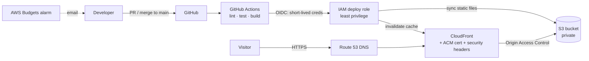

# 03 · Architecture

> Decisions are recorded in [decisions/](decisions/). Status: app stack **Accepted** ([ADR-0002](decisions/0002-static-site-nextjs-git-content.md)); AWS hosting **Accepted** ([ADR-0003](decisions/0003-hosting-on-aws.md)): `aws-calderon` account, `eu-west-2` (London).

## Tech stack

| Concern | Choice | Why |
|---|---|---|
| Framework | **Next.js (App Router), static export** | Static pages for speed/SEO/low cost; file-based routing fits member/project pages; industry-standard |
| Language | **TypeScript (strict)** | Type-safe content model, catches errors early |
| Styling | **Tailwind CSS** | Fast iteration, consistent design tokens |
| Content | **MDX with frontmatter in the repo** | No database; versioned; edited via PR |
| Content validation | **Zod** | Build fails on invalid content (FR-31) |
| Testing | **Vitest** (unit) + **Playwright** (e2e smoke tests) | Fast, modern, good TS support |
| Quality | ESLint + Prettier + Husky/lint-staged | Consistent code across contributors |
| CI/CD | **GitHub Actions** | Lint, type-check, test, build on every PR; deploy on merge to `main` |
| Hosting | **AWS S3 + CloudFront** | See ADR-0003 |
| Infrastructure as code | **AWS CDK (TypeScript)** | Same language as the app; reviewable infra |

## Hosting architecture



**Notes**
- `next.config` uses `output: "export"` and `trailingSlash: true`, so `/members/israel/` maps to `members/israel/index.html` in S3 without needing URL-rewrite functions.
- All resources live in **eu-west-2 (London)**, except the ACM certificate for CloudFront, which must be in **us-east-1**. The certificate is only needed once we add a custom domain at M5. Until then we use the free `*.cloudfront.net` URL.
- Cost guardrails (zero-spend budget, no WAF/KMS/NAT, tagging `project=casa-calderon`) are listed in ADR-0003.
- Account setup (M1): root user MFA'd and locked away, IAM Identity Center user for daily work, budget alarm, `cdk bootstrap`.
- PR preview environments are deferred (a good later learning exercise).

## Future AWS/AI ideas (post-launch, each needs its own ADR)

- **"Ask the family" assistant:** Amazon Bedrock answering questions about our projects using our own content (RAG), behind API Gateway + Lambda, with rate limiting and strict cost caps.
- **Contact form:** API Gateway + Lambda + SES, with spam protection.
- **Monitoring:** CloudWatch dashboards/alarms, CloudFront access logs.

## Content model (draft)

```ts
type Member = {
  slug: string;              // "israel" → /members/israel
  name: string;              // "Israel Calderon"
  kind: "core" | "family";   // core = developer members; family = e.g. parents (FR-18)
  role: string;              // "Full-stack Developer"
  tagline?: string;
  bio: string;               // Markdown body
  avatar: string;            // path to image
  skills?: { category: string; items: string[] }[];   // optional for non-dev members
  experience?: {
    title: string; org: string; start: string; end?: string; summary?: string;
    kind: "work" | "education" | "achievement";
  }[];
  certifications?: { name: string; issuer: string; date: string; url?: string }[];
  interests?: string[];      // "Beyond the code" (FR-16)
  links: { github?: string; linkedin?: string; website?: string; cv?: string; email?: string };
  status?: string;           // "Available for freelance"
  order: number;             // display order on the collective page
};

type Project = {
  slug: string;
  title: string;
  summary: string;           // one-liner for cards
  body: string;              // MDX: problem, approach, outcome
  members: string[];         // Member slugs; 2+ = joint project
  type: "professional" | "personal";
  confidential?: boolean;    // hide code/links (FR-23)
  tech: string[];
  links?: { repo?: string; live?: string; caseStudy?: string };
  images?: { src: string; alt: string }[];
  date: string;              // ISO, for sorting
  featured?: boolean;        // show on collective page
};
```

## Folder structure

```
family-portfolio/
├─ content/
│  ├─ members/            # israel.mdx, cristhyan.mdx, marcy.mdx, benjamin.mdx
│  └─ projects/           # one file per project
├─ public/images/         # avatars, project screenshots
├─ src/
│  ├─ app/                # Next.js routes
│  │  ├─ page.tsx                      # collective / home
│  │  ├─ members/[slug]/page.tsx       # member page
│  │  ├─ projects/page.tsx             # project list + filters
│  │  └─ projects/[slug]/page.tsx      # project detail
│  ├─ components/         # UI components
│  └─ lib/content/        # loaders + Zod schemas (single data layer)
├─ infra/                 # AWS CDK app (TypeScript)
├─ tests/                 # e2e tests
├─ docs/                  # this documentation
└─ .github/workflows/     # CI + deploy
```

## Routes

| Route | Page |
|---|---|
| `/` | Collective landing page |
| `/members/[slug]` | Individual member page |
| `/projects` | All projects, filterable |
| `/projects/[slug]` | Project detail |
| `/#contact` | Contact section on the home page |
