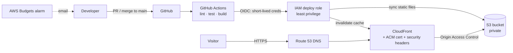
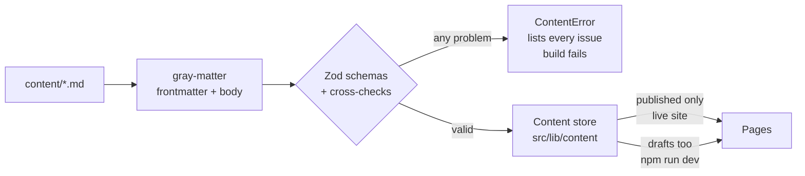

# 03 · Architecture

> Decisions are recorded in [decisions/](decisions/). Status: app stack **Accepted** ([ADR-0002](decisions/0002-static-site-nextjs-git-content.md)); AWS hosting **Accepted** ([ADR-0003](decisions/0003-hosting-on-aws.md)): `aws-calderon` account, `eu-west-2` (London).

## Tech stack

| Concern                | Choice                                               | Why                                                                                                  |
| ---------------------- | ---------------------------------------------------- | ---------------------------------------------------------------------------------------------------- |
| Framework              | **Next.js (App Router), static export**              | Static pages for speed/SEO/low cost; file-based routing fits member/project pages; industry-standard |
| Language               | **TypeScript (strict)**                              | Type-safe content model, catches errors early                                                        |
| Styling                | **Tailwind CSS**                                     | Fast iteration, consistent design tokens                                                             |
| Content                | **MDX with frontmatter in the repo**                 | No database; versioned; edited via PR                                                                |
| Content validation     | **Zod**                                              | Build fails on invalid content (FR-31)                                                               |
| Testing                | **Vitest** (unit) + **Playwright** (e2e smoke tests) | Fast, modern, good TS support                                                                        |
| Quality                | ESLint + Prettier + Husky/lint-staged                | Consistent code across contributors                                                                  |
| CI/CD                  | **GitHub Actions**                                   | Lint, type-check, test, build on every PR; deploy on merge to `main`                                 |
| Hosting                | **AWS S3 + CloudFront**                              | See ADR-0003                                                                                         |
| Infrastructure as code | **AWS CDK (TypeScript)**                             | Same language as the app; reviewable infra                                                           |

## Hosting architecture



**Notes**

- `next.config` uses `output: "export"` and `trailingSlash: true`, so pages are written as `members/israel/index.html`. CloudFront only applies its default root object at `/`, so a small **CloudFront Function** (`infra/lib/functions/url-rewrite.js`, free tier) maps `/members/israel/` to `.../index.html` and 301-redirects `/members/israel` to the trailing-slash URL.
- The infrastructure is defined in [`infra/`](../infra/README.md) (CDK, TypeScript): resources, safety settings, trade-offs (e.g. the CSP allows `'unsafe-inline'` scripts, which Next.js static export needs) and commands.
- All resources live in **eu-west-2 (London)**, except the ACM certificate for CloudFront, which must be in **us-east-1**. The certificate is only needed once we add a custom domain at M5. Until then we use the free `*.cloudfront.net` URL.
- Cost guardrails (zero-spend budget, no WAF/KMS/NAT, tagging `project=casa-calderon`) are listed in ADR-0003.
- Account setup (M1): root user MFA'd and locked away, IAM Identity Center user for daily work, budget alarm, `cdk bootstrap`.
- PR preview environments are deferred (a good later learning exercise).

## Future AWS/AI ideas (post-launch, each needs its own ADR)

- **"Ask the family" assistant:** Amazon Bedrock answering questions about our projects using our own content (RAG), behind API Gateway + Lambda, with rate limiting and strict cost caps.
- **Contact form:** API Gateway + Lambda + SES, with spam protection.
- **Monitoring:** CloudWatch dashboards/alarms, CloudFront access logs.

## Content model

> **Source of truth:** [`src/lib/content/schema.ts`](../src/lib/content/schema.ts) (Zod). Decision and trade-offs: [ADR-0005](decisions/0005-content-pipeline.md). How to write content: [CONTRIBUTING.md](../CONTRIBUTING.md#adding-your-content).

Each member and project is **one Markdown file**: YAML frontmatter for structured data, the Markdown body for prose. The file name is the URL slug.

| Collection             | File                                       | Frontmatter (required in **bold**)                                                                                                                                                                                            | Body                      |
| ---------------------- | ------------------------------------------ | ----------------------------------------------------------------------------------------------------------------------------------------------------------------------------------------------------------------------------- | ------------------------- |
| Member                 | `content/members/<slug>.md`                | **name**, **role**, **order**, `kind` (`core`/`family`), `published`, `tagline`, `avatar`, `status`, `skills`, `experience` (with `location`, `highlights`), `languages`, `certifications`, `interests`, `links` (incl. `cv`) | Bio (required for `core`) |
| Project                | `content/projects/<slug>.md`               | **title**, **summary** (max 160 characters), **members** (member slugs), **type** (`professional`/`personal`), **date**, `confidential`, `tech`, `links`, `images` (`alt` required), `featured`, `published`                  | Write-up                  |
| Collective (home page) | `content/collective.md` (single, optional) | **tagline** (max 120), **pitch** (max 300), **services** (at least one `title` + `description`), `contact`, `cover` (`src` base path + `alt`; files must exist), `published`                                                  | "Our story"               |

### Data flow



- **Validation runs before every build** (`prebuild` → `npm run content:check`) and in CI (a test loads the real `content/`). It covers **drafts too**.
- **Strict:** unknown keys (typos) are errors; URLs and emails are validated; project `members` must exist; confidential projects can't have links.
- **Drafts:** `published: false` (the default) is shown only in `npm run dev` (or with `SHOW_DRAFTS=true`). The live site shows only `published: true` (NFR-6 sign-off).
- **Pages read content only through** `getMembers()`, `getMember(slug)`, `getProjects({ member, type })`, `getProject(slug)` in `src/lib/content`. Never `fs` directly.

## Folder structure

```
family-portfolio/
├─ content/
│  ├─ members/            # israel.md, cristhyan.md, marcy.md, benjamin.md
│  └─ projects/           # one .md file per project
├─ public/images/         # avatars, project screenshots
├─ src/
│  ├─ app/                # Next.js routes
│  │  ├─ page.tsx                      # collective / home
│  │  ├─ members/[slug]/page.tsx       # member page
│  │  ├─ projects/page.tsx             # project list + filters
│  │  └─ projects/[slug]/page.tsx      # project detail
│  ├─ components/         # UI components
│  └─ lib/content/        # Zod schemas, loader, content store (single data layer)
├─ scripts/               # check-content.ts (runs before every build)
├─ infra/                 # AWS CDK app (TypeScript)
├─ tests/                 # e2e tests
├─ docs/                  # this documentation
└─ .github/workflows/     # CI + deploy
```

## Routes

| Route              | Page                             |
| ------------------ | -------------------------------- |
| `/`                | Collective landing page          |
| `/members/[slug]`  | Individual member page           |
| `/projects`        | All projects, filterable         |
| `/projects/[slug]` | Project detail                   |
| `/#contact`        | Contact section on the home page |
