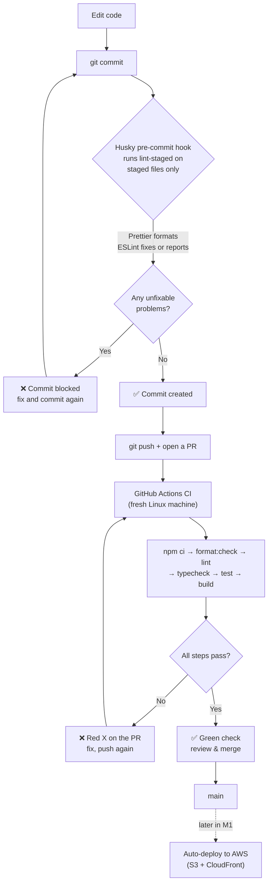

# 06 · Development Workflow

How code gets from your editor to `main`, and the automatic checks that keep `main` healthy. Read this before your first contribution.

## The three safety nets

| Layer                     | Tools                                                  | When it runs                   | Speed         | Can be skipped?                              |
| ------------------------- | ------------------------------------------------------ | ------------------------------ | ------------- | -------------------------------------------- |
| 1. Editor                 | ESLint + Prettier VS Code extensions                   | As you type / on save          | Instant       | Yes, it's advisory                           |
| 2. Pre-commit hook        | Husky + lint-staged (ESLint, Prettier)                 | On `git commit`                | A few seconds | Yes (`--no-verify`), but don't               |
| 3. Continuous integration | GitHub Actions (format, lint, type-check, test, build) | On every PR and push to `main` | 1–3 minutes   | No. It's the final say, and required from M3 |

Each layer is slower but more thorough than the one before. Most problems are caught in layer 1 or 2, so CI is rarely red.

## The flow

Running in the background on every commit, `.gitattributes` makes the repo store all text files with **LF** line endings, whatever OS you're on.

## What each tool does

### Prettier: formatting

Formats code and docs (`.ts`, `.tsx`, `.css`, `.json`, `.md`, `.yml`) the same way for everyone, so code reviews are about logic, not spacing. Config: `.prettierrc.json`, ignores in `.prettierignore`.

### ESLint: code quality

Catches bugs and bad patterns: unused variables, broken React hook rules, accessibility issues in JSX, Next.js-specific mistakes. Config: `eslint.config.mjs`, which uses Next.js's recommended rules plus `eslint-config-prettier` (turns off the rules that would fight with Prettier).

### Husky + lint-staged: the pre-commit hook

Git can run scripts at certain moments (**hooks**). Normally hooks live in `.git/hooks/`, which isn't shared. **Husky** keeps them in the committed `.husky/` folder and installs them automatically when you run `npm install`, so everyone gets the same hook. **lint-staged** makes the hook fast by only checking the files you're committing. The config is the `lint-staged` key in `package.json`.

### Vitest: tests

Runs `*.test.ts(x)` files in `src/`. Today there's one example test (`src/lib/site.test.ts`). In M2, tests will check content validation, e.g. "a member file without a `name` fails with a clear error", which protects the live site when members edit their own content.

### `.gitattributes`: line endings

Windows uses CRLF line endings; Mac/Linux use LF. This file makes the repo always store LF, so diffs don't show every line as changed when a Windows user and a Mac user edit the same file.

### GitHub Actions CI

Defined in `.github/workflows/ci.yml`. On every PR, GitHub starts a clean Linux machine, installs exactly what's in `package-lock.json` (`npm ci`), and runs every check across the **whole** project. This catches what the hook can't: skipped hooks, problems that only appear when files interact, "works on my machine" issues, and build failures.

## Everyday commands

| Command              | What it does                                                  |
| -------------------- | ------------------------------------------------------------- |
| `npm run dev`        | Start the local dev server at http://localhost:3000           |
| `npm run build`      | Build the static site into `out/` (what gets deployed)        |
| `npm run check`      | Run format check + lint + type-check + tests (CI minus build) |
| `npm run format`     | Auto-format everything with Prettier                          |
| `npm run lint`       | Run ESLint                                                    |
| `npm run typecheck`  | Generate Next.js route types, then run TypeScript             |
| `npm test`           | Run tests once                                                |
| `npm run test:watch` | Re-run tests as you change files                              |

**Tip:** run `npm run check` before pushing, and CI will almost never surprise you.

## Troubleshooting

**"My commit was blocked."** Read the output: it names the file, line and rule. Fix it, `git add` the file again, and commit again. Formatting issues are fixed automatically; only real code problems block you.

**"I need to commit right now and the hook is in the way."** `git commit --no-verify` skips the hook. CI will still catch the problem, so use this only in emergencies.

**"The hook didn't run."** Run `npm install` (this re-installs the hooks via the `prepare` script), and check `git config core.hooksPath` prints `.husky/_`.

**"Prettier says every line in a file is wrong."** That's probably CRLF line endings from before `.gitattributes` existed. Run `npm run format` to fix it.

**"Wrong Node version" / engine warnings.** The project uses Node 26 (pinned in `.nvmrc`). See the [README](../README.md#getting-started) for setting up `fnm`.
