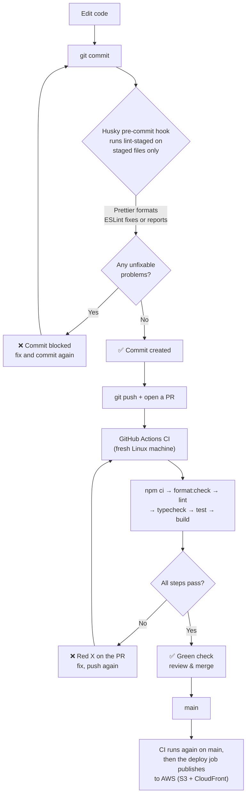
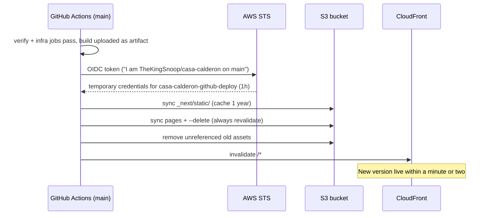

# 06 · Development Workflow

How code gets from your editor to `main`, and the automatic checks that keep `main` healthy. Read this before your first contribution.

## The three safety nets

| Layer                     | Tools                                                  | When it runs                   | Speed         | Can be skipped?                                                                |
| ------------------------- | ------------------------------------------------------ | ------------------------------ | ------------- | ------------------------------------------------------------------------------ |
| 1. Editor                 | ESLint + Prettier VS Code extensions                   | As you type / on save          | Instant       | Yes, it's advisory                                                             |
| 2. Pre-commit hook        | Husky + lint-staged (ESLint, Prettier)                 | On `git commit`                | A few seconds | Yes (`--no-verify`), but don't                                                 |
| 3. Continuous integration | GitHub Actions (format, lint, type-check, test, build) | On every PR and push to `main` | 1–3 minutes   | No. The "Protect main" ruleset requires it (admins can bypass in an emergency) |

Each layer is slower but more thorough than the one before. Most problems are caught in layer 1 or 2, so CI is rarely red.

## The flow



Running in the background on every commit, `.gitattributes` makes the repo store all text files with **LF** line endings, whatever OS you're on.

## What each tool does

### Prettier: formatting

Formats code and docs (`.ts`, `.tsx`, `.css`, `.json`, `.md`, `.yml`) the same way for everyone, so code reviews are about logic, not spacing. Config: `.prettierrc.json`, ignores in `.prettierignore`.

### ESLint: code quality

Catches bugs and bad patterns: unused variables, broken React hook rules, accessibility issues in JSX, Next.js-specific mistakes. Config: `eslint.config.mjs`, which uses Next.js's recommended rules plus `eslint-config-prettier` (turns off the rules that would fight with Prettier).

### Husky + lint-staged: the pre-commit hook

Git can run scripts at certain moments (**hooks**). Normally hooks live in `.git/hooks/`, which isn't shared. **Husky** keeps them in the committed `.husky/` folder and installs them automatically when you run `npm install`, so everyone gets the same hook. **lint-staged** makes the hook fast by only checking the files you're committing. The config is the `lint-staged` key in `package.json`.

### Vitest: tests

Runs `*.test.ts(x)` files in `src/`. Today there's one example test (`src/lib/site.test.ts`). In M2, tests will check content validation, e.g. "a member file without a `name` fails with a clear error", which protects the live site when members edit their own content.

### `.gitattributes`: line endings

Windows uses CRLF line endings; Mac/Linux use LF. This file makes the repo always store LF, so diffs don't show every line as changed when a Windows user and a Mac user edit the same file.

### GitHub Actions CI

Defined in `.github/workflows/ci.yml`. On every PR, GitHub starts a clean Linux machine, installs exactly what's in `package-lock.json` (`npm ci`), and runs every check across the **whole** project. This catches what the hook can't: skipped hooks, problems that only appear when files interact, "works on my machine" issues, and build failures.

CI has three check jobs that run in parallel, plus a deploy job on `main`:

- **Format, lint, type-check, test, build:** the website (repo root).
- **Infra:** the AWS CDK app in `infra/` (type-check, tests, `cdk synth`). It never talks to AWS. See [infra/README.md](../infra/README.md).
- **End-to-end (Playwright):** real-browser smoke tests (see below).
- **Deploy (only on `main`, only if all three checks pass):** publishes the site. See below.

### End-to-end tests (Playwright)

Real-browser tests in `tests/e2e/`, run in headless Chromium against **two builds** of the site:

| Project  | Build                           | What it proves                                                                                                                                  |
| -------- | ------------------------------- | ----------------------------------------------------------------------------------------------------------------------------------------------- |
| `drafts` | `SHOW_DRAFTS=true` (every page) | Pages render, links and filters work, skip link and keyboard navigation work, unknown pages 404, trailing-slash redirects keep the query string |
| `live`   | Normal production build         | **Exactly what gets deployed:** "Coming soon", no draft names or placeholder text anywhere, draft pages are 404, security headers present       |

- **Served like CloudFront:** `scripts/serve-static.ts` copies the URL function and sends the **production security headers** (shared with the CDK stack via `infra/lib/security-headers.ts`).
- **Every test fails on a console error or CSP violation**, so a security policy that would break the live site fails CI first.
- **When someone publishes their page,** the `live` tests that expect "nothing personal" need updating in the same PR. That's deliberate: publishing should be a conscious change.

Run them locally:

```bash
npx playwright install chromium   # once per machine (~120 MB)
npm run e2e:all                   # build both sites, then run the tests
npm run e2e                       # re-run tests without rebuilding
npm run e2e:report                # open the HTML report after a failure
```

If CI fails, download the **playwright-report** artifact from the run: it includes traces you can replay step by step with `npx playwright show-trace`.

### How a merge becomes a live site



- **The exact build that passed the checks is the one deployed.** It's passed between jobs as an artifact, not rebuilt.
- **No AWS keys are stored in GitHub.** The deploy role only trusts this repo's `main` branch and can only touch the site bucket and distribution.
- **The values it needs** (role ARN, bucket, distribution ID) are repository **variables** (Settings → Secrets and variables → Actions → Variables). None of them are secrets.
- **Caching:** files in `_next/static/` have content hashes in their names, so they're cached for a year. HTML is always revalidated, so visitors see new content right after a deploy.
- **If a deploy fails,** the previous version stays live. Fix forward with a new PR, or re-run the job from the Actions tab.

## Everyday commands

| Command                                     | What it does                                                                                                                                                                                                                                                                                                 |
| ------------------------------------------- | ------------------------------------------------------------------------------------------------------------------------------------------------------------------------------------------------------------------------------------------------------------------------------------------------------------ |
| `npm run dev`                               | Start the local dev server at http://localhost:3000                                                                                                                                                                                                                                                          |
| `npm run build`                             | Build the static site into `out/` (what gets deployed)                                                                                                                                                                                                                                                       |
| `npm run check`                             | Run format check + lint + type-check + tests + content check (CI minus build)                                                                                                                                                                                                                                |
| `npm run content:check`                     | Validate every file in `content/`; also runs automatically before `npm run build`                                                                                                                                                                                                                            |
| `npm run format`                            | Auto-format everything with Prettier                                                                                                                                                                                                                                                                         |
| `npm run lint`                              | Run ESLint                                                                                                                                                                                                                                                                                                   |
| `npm run typecheck`                         | Generate Next.js route types, then run TypeScript                                                                                                                                                                                                                                                            |
| `npm test`                                  | Run tests once                                                                                                                                                                                                                                                                                               |
| `npm run test:watch`                        | Re-run tests as you change files                                                                                                                                                                                                                                                                             |
| `npm run e2e:all`                           | Build both test sites and run the Playwright end-to-end tests (see above)                                                                                                                                                                                                                                    |
| `npm run images -- <photo> <folder> <name>` | Make web-ready AVIF/WebP sizes of a photo in `public/images/<folder>/`, with metadata (incl. GPS) stripped. See CONTRIBUTING "Adding photos"                                                                                                                                                                 |
| `npm run infra:*`                           | Infra shortcuts from the repo root: `infra:install`, `infra:check`, `infra:synth`, `infra:whoami`, `infra:whoami:admin`, `infra:diff`, `infra:diff:changeset`, `infra:deploy` (see [infra/README.md](../infra/README.md)). Pass extra CDK flags after `--`, e.g. `npm run infra:deploy -- --progress events` |

**Tip:** run `npm run check` before pushing, and CI will almost never surprise you.

### `npm ci` vs `npm install`

- **`npm ci`**: use this after cloning or pulling. It deletes `node_modules` and installs _exactly_ what `package-lock.json` says. It never changes the lockfile.
- **`npm install <package>`**: use this only when you're **adding, removing or upgrading** a package. It updates `package.json` and `package-lock.json`, and both changes belong in your PR.

If `package-lock.json` shows up as modified and you didn't change any packages, something's off (usually the wrong Node/npm version). Don't commit it: run `git restore package-lock.json`, check `node --version`, then `npm ci`.

## Troubleshooting

**"My CSS change doesn't show up in `npm run build` / the e2e tests."** Turbopack's build cache in `.next/` can serve a stale stylesheet. Delete `.next/` and build again. `npm run e2e:build` does this automatically. Stop your `npm run dev` first: deleting `.next/` under a running dev server makes it recompile, or show errors until you restart it.

**"Another next dev server is already running."** Next.js 16 allows one dev server per project. Use the existing one (the message shows its URL), or stop it first.

**"My commit was blocked."** Read the output: it names the file, line and rule. Fix it, `git add` the file again, and commit again. Formatting issues are fixed automatically; only real code problems block you.

**"I need to commit right now and the hook is in the way."** `git commit --no-verify` skips the hook. CI will still catch the problem, so use this only in emergencies.

**"The hook didn't run."** Run `npm install` (this re-installs the hooks via the `prepare` script), and check `git config core.hooksPath` prints `.husky/_`.

**"Prettier says every line in a file is wrong."** That's probably CRLF line endings from before `.gitattributes` existed. Run `npm run format` to fix it.

**`npm ERR! code EBADENGINE` / "Not compatible with your version of node".** The project requires Node 26 (pinned in `.nvmrc`), and `.npmrc` (`engine-strict=true`) stops installs on any other version on purpose. Run `node --version`. If it isn't 26, set up `fnm` (see the [README](../README.md#getting-started)), restart your terminal **and VS Code** (terminals opened before fnm was installed keep the old Node), then run `npm ci`.
