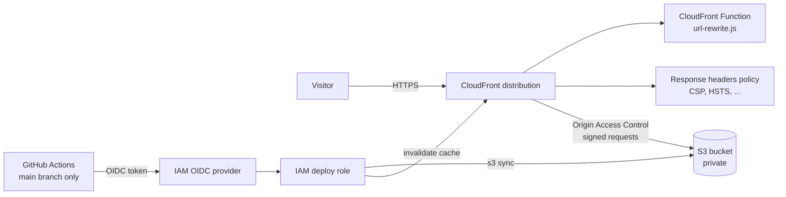

# Infrastructure (AWS CDK)

The AWS resources that host Casa Calderon, defined in TypeScript with the [AWS CDK](https://docs.aws.amazon.com/cdk/v2/guide/home.html). The decision behind this setup is in [ADR-0003](../docs/decisions/0003-hosting-on-aws.md).

- **Account:** `aws-calderon` (`804450520614`)
- **Region:** `eu-west-2` (London)
- **Stack:** `CasaCalderonSite`

## What gets created



| Resource                                  | Why it exists                                                                                                                                                                                   | Cost                                               |
| ----------------------------------------- | ----------------------------------------------------------------------------------------------------------------------------------------------------------------------------------------------- | -------------------------------------------------- |
| **S3 bucket** (private)                   | Stores the static files from `next build` (`out/`). Public access blocked; HTTPS-only; encrypted with SSE-S3                                                                                    | Pennies at most (a few MB)                         |
| **Origin Access Control** + bucket policy | Only _this_ CloudFront distribution can read the bucket, using signed requests                                                                                                                  | Free                                               |
| **CloudFront distribution**               | HTTPS, global cache, gzip/brotli, HTTP/2 + 3. `PriceClass_100` (Europe + North America edges)                                                                                                   | Free tier (1 TB transfer / 10M requests per month) |
| **CloudFront Function** `url-rewrite.js`  | `/members/israel/` → `.../index.html`; `/members/israel` → 301 to the trailing-slash URL                                                                                                        | Free tier (2M invocations per month)               |
| **Response headers policy**               | Security headers: CSP, HSTS (1 year), `X-Content-Type-Options`, `X-Frame-Options: DENY`, Referrer & Permissions policy                                                                          | Free                                               |
| **IAM OIDC provider** (GitHub)            | Lets GitHub Actions prove its identity to AWS, so there are **no stored AWS keys**                                                                                                              | Free                                               |
| **IAM deploy role**                       | Assumable **only** by workflows on `TheKingSnoop/casa-calderon` `main` (matched by immutable repo ID). Can only list/get/put/delete objects in the site bucket and invalidate this distribution | Free                                               |

Every taggable resource gets `project=casa-calderon` for Cost Explorer.

### Safety settings

- **Termination protection** is on: the stack can't be deleted until someone turns it off on purpose.
- **The bucket is retained** if the stack is ever deleted.
- **`requireApproval: broadening`** (in `cdk.json`): `cdk deploy` stops and asks before adding any IAM permission or security-group change.
- **Explicit account + region**: the stack can't accidentally deploy to another account.
- **CDK CLI telemetry is disabled** (`cli-telemetry: false` in `cdk.json`).

### Notes and trade-offs

- **CSP allows `'unsafe-inline'` scripts.** Next.js static export inlines small bootstrap scripts, and without a server we can't add per-request nonces. Everything else is locked to `'self'`. Revisit if we add hashes at build time.
- **GitHub uses the _immutable subject_ format for this repo.** The OIDC `sub` claim is `repo:TheKingSnoop@138521589/casa-calderon@1456781007:ref:refs/heads/main` (owner and repo **numeric IDs**), not `repo:TheKingSnoop/casa-calderon:...`. IDs are never reused, so a deleted or renamed repo recreated under the same name can't assume our role. The value lives in `lib/config.ts` (`githubOidcRepo`). If deploys fail with `Not authorized to perform sts:AssumeRoleWithWebIdentity`, compare it with `gh api repos/TheKingSnoop/casa-calderon/actions/oidc/customization/sub`, or look up the failed `AssumeRoleWithWebIdentity` event in CloudTrail (its `userName` is the exact `sub` GitHub sent).
- **The GitHub OIDC provider is account-wide.** AWS allows only one per URL. Any other project in this account that deploys from GitHub should reference this provider instead of creating its own.
- **Missing pages:** S3 answers `403` for files that don't exist (we deliberately don't grant `ListBucket` to CloudFront), so `403` and `404` both show `/404.html` with status `404`.

## Commands

Run from `infra/` (or from the repo root as `npm run infra:<name>`). You need Node 26 (`.nvmrc`) and, for anything that talks to AWS, a valid SSO session. One login covers both profiles below:

```bash
aws sso login --sso-session casa-calderon
```

### Two AWS profiles (least privilege)

| Profile                  | Identity Center role  | Use it for                                                       |
| ------------------------ | --------------------- | ---------------------------------------------------------------- |
| `casa-calderon-readonly` | `ReadOnlyAccess`      | **Default.** Checks: who am I, what's deployed, billing, diffs   |
| `casa-calderon`          | `AdministratorAccess` | Only for changes: `deploy`, `bootstrap`, and the change-set diff |

The read-only role can't write anything, and it **can't assume CDK's deploy roles**, so CDK can't be used to get around it. Tested: an S3 upload returns `AccessDenied` and an EC2 dry-run returns `UnauthorizedOperation`.

| Command                  | Profile   | Talks to AWS?                  | What it does                                                                            |
| ------------------------ | --------- | ------------------------------ | --------------------------------------------------------------------------------------- |
| `npm run typecheck`      | none      | No                             | TypeScript check                                                                        |
| `npm test`               | none      | No                             | CDK assertion tests + CloudFront Function tests                                         |
| `npm run synth`          | none      | No                             | Generate the CloudFormation template into `cdk.out/`                                    |
| `npm run whoami`         | read-only | Read-only                      | Show which identity you're using                                                        |
| `npm run diff`           | read-only | Read-only                      | Template-only diff: code vs deployed (`--method=template`)                              |
| `npm run whoami:admin`   | admin     | Read-only                      | Check the admin profile works                                                           |
| `npm run diff:changeset` | admin     | Creates a temporary change set | Most accurate diff, incl. whether resources would be **replaced**. Use before deploys   |
| `npm run bootstrap`      | admin     | **Yes** (one-time)             | Create CDK's helper stack (`CDKToolkit`) in `eu-west-2`                                 |
| `npm run deploy`         | admin     | **Yes**                        | Create/update the `CasaCalderonSite` stack (shows the diff and asks before IAM changes) |

Every AWS command passes an explicit `--profile`, so nothing ever falls back to the `[default]` profile.

## Account baseline (console, not CDK)

Account-wide security settings were set up once in the console. They aren't part of this stack, because they belong to the account, not to the site:

| Setting                              | Where                            | Notes                                                                                                                                                                      |
| ------------------------------------ | -------------------------------- | -------------------------------------------------------------------------------------------------------------------------------------------------------------------------- |
| AWS Budgets: $1/month, alert > $0.01 | Billing → Budgets                | Email on any actual spend                                                                                                                                                  |
| IAM Identity Center (org instance)   | eu-west-2                        | User `israel`, MFA every sign-in; permission sets `AdministratorAccess` (4h) and `ReadOnlyAccess` (8h)                                                                     |
| IAM Access Analyzer: external access | IAM → Access analyzer, eu-west-2 | **Free.** Flags anything shared outside the account. 0 findings (2026-11-23). Don't add "unused"/"internal" analyzers: they're **paid**                                    |
| CDK bootstrap (`CDKToolkit`)         | `npm run bootstrap`              | Its CloudFormation execution role uses `AdministratorAccess` (CDK default). **Deferred:** scope it down before anyone else gets infrastructure-deploy access (see Roadmap) |

## Files

```
infra/
├─ bin/app.ts                    # entry point: creates the stack with account/region/tags
├─ lib/config.ts                 # account, region, repo, branch, tags
├─ lib/site-stack.ts             # all resources (commented section by section)
├─ lib/functions/url-rewrite.js  # CloudFront Function code
├─ test/                         # Vitest tests (run in CI)
├─ cdk.json                      # how to run the app + CDK feature flags
└─ AGENTS.md                     # CDK's guidance for AI coding assistants
```
